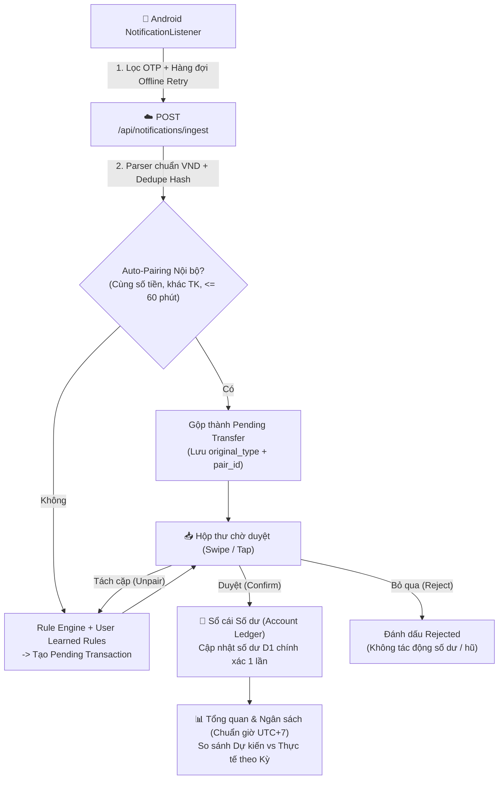

# TÀI LIỆU ĐẶC TẢ RÀ SOÁT & TỐI ƯU HÓA TOÀN DIỆN — QLTC CÁ NHÂN (`tối ưu V1.md`)

> **Phiên bản cơ sở được rà soát:** `v1.1.2` (`versionCode = 10`)  
> **Mục đích tài liệu:** Tài liệu đặc tả kỹ thuật chuẩn hóa (Agent-Ready Specification) dùng để AI Coding Agent đọc và triển khai tuần tự nhằm khắc phục triệt để các lỗi logic/toán học tài chính, chuẩn hóa luồng dữ liệu End-to-End và nâng cấp trải nghiệm UI/UX đạt chuẩn ứng dụng Fintech thực chiến.

---

## 0. QUY TẮC BẮT BUỘC DÀNH CHO AGENT KHI TRIỂN KHAI (`MANDATORY AGENT RULES`)

Mọi Agent khi đọc và thực thi tài liệu này **BẮT BUỘC** tuân thủ 5 nguyên tắc bất biến sau:

1. **Quy tắc nhảy Version đồng bộ (6 vị trí):**
   - Mỗi lần hoàn thành một Phase sửa lỗi hoặc thêm tính năng mới, **BẮT BUỘC** phải tăng số phiên bản (`PATCH` cho sửa lỗi nhỏ, `MINOR` cho nâng cấp tính năng/tối ưu lớn — ví dụ từ `v1.1.2` lên `v1.2.0`, `versionCode` từ `10` lên `11`) đồng bộ tại **đúng 6 file**:
     1. `frontend/src/components/Navbar.tsx` (hiển thị badge version cạnh lời chào)
     2. `frontend/src/components/SettingsModal.tsx` (hằng số `CURRENT_APP_VERSION`)
     3. `frontend/src/worker.ts` (URL redirect `/apk` và `/download` trỏ tới bản release mới nhất)
     4. `backend/src/index.ts` (version trả về tại healthcheck `GET /`)
     5. `android/app/build.gradle.kts` (`versionCode` tăng `+1`, `versionName` khớp semver)
     6. `.github/workflows/build-apk.yml` (tên file APK, `tag_name`, `name`, và nội dung Release Notes)
2. **Bảo toàn tuyệt đối dữ liệu người dùng trên Cloudflare D1 (`qltc-db`):**
   - Tuyệt đối **KHÔNG** dùng `DROP TABLE` đối với các bảng đang lưu dữ liệu thật (`users`, `accounts`, `income_sources`, `jars`, `transactions`, `raw_notifications`, `assets`, `holdings`).
   - Mọi thay đổi cấu trúc bảng phải viết dưới dạng Idempotent Migration (`ALTER TABLE ... ADD COLUMN ...` bọc trong `try / catch` hoặc kiểm tra `PRAGMA table_info(...)`).
3. **Chuẩn số học tiền tệ VND:**
   - Toàn bộ số tiền VND (`amount`, `balance`, `monthly_limit`, `expected_amount`) phải được làm tròn số nguyên (`Math.round()`) trước khi lưu DB; không để số thực dấu phẩy động lẻ thập phân gây lệch tổng `1 ₫`.
   - Mọi tỷ lệ phần trăm phân bổ hũ dự kiến và thực tế khi chuẩn hóa phải dùng thuật toán **Largest Remainder Method (Phương pháp số dư lớn nhất)** để tổng hiển thị luôn bằng **đúng `100%`** (hoặc `0%` khi chưa phát sinh dữ liệu).
4. **Ngôn ngữ thiết kế chủ đạo (`Dark Matte Slate Luxury`):**
   - Giữ vững bảng màu sang trọng dịu mắt: Nền chính `#0E1314`, Thẻ `#161E20`, Thẻ phụ `#1C2628`, Viền mảnh `#232F32`, Điểm nhấn chính `#95B0B4` / `#657D81`, Xanh tăng trưởng `#8CC7AE`, Cam cảnh báo `#D4A373`, Đỏ chi vượt `#E08A8A`.
   - Mọi con số tài chính bắt buộc áp dụng `tabular-nums` để thẳng hàng dọc tuyệt đối.
5. **Kiểm chứng trước khi kết thúc mỗi Phase:**
   - Phải chạy `npm run build` tại `frontend/` và kiểm tra TypeScript tại `backend/` đạt **0 lỗi** trước khi commit, deploy Cloudflare Workers (`qltc-backend`, `qltc-app`) và push kích hoạt GitHub Actions build APK.

---

## PHẦN I — RÀ SOÁT LOGIC, PHÉP TÍNH & LUỒNG DỮ LIỆU (13 VẤN ĐỀ CỐT LÕI & GIẢI PHÁP)

### Tổng quan Sơ đồ Luồng Dữ liệu Chuẩn Hóa (Target Data-Flow Architecture)



---

### L-01 [CRITICAL] Bất đồng bộ Sổ cái Số dư Tài khoản (`Account Balance Ledger`)

- **Vị trí lỗi hiện tại:**
  - `backend/src/index.ts` (dòng `143–146`, `486–496`, `514–572`, `576–586`)
  - `frontend/src/App.tsx` (dòng `249–308`, `480–515`)
- **Hiện trạng & Sai lệch toán học:**
  1. **Cộng/trừ sai thời điểm khi nhận thông báo:** Ở `POST /api/notifications/ingest`, nếu tin nhắn ngân hàng có `balanceAfter`, Backend cập nhật ngay `accounts.balance = balanceAfter` dù giao dịch đang ở trạng thái `pending`. Nếu sau đó người dùng bấm **Bỏ qua (`rejected`)**, số dư tài khoản đã bị biến đổi mà không hoàn lại. Ngược lại, nếu thông báo ngân hàng **không có** `balanceAfter` (ví dụ thông báo rút gọn của ví điện tử hoặc một số app ngân hàng), khi người dùng bấm **Duyệt (`confirmed`)** tại `PUT /api/transactions/:id`, Backend **không hề cộng/trừ `amount` vào `accounts.balance`**!
  2. **Xóa giao dịch đã duyệt không hoàn số dư & hũ:** Hàm `DELETE /api/transactions/:id` trên Backend chỉ xóa dòng trong bảng `transactions` mà không hoàn trả `amount` vào `accounts.balance`. Trên Frontend (`handleDeleteConfirmed`), `jar.spentThisMonth` và `accounts.balance` cũng không được hoàn lại cho đến khi reload trang.
  3. **Lệch số dư giữa Frontend & Backend khi tạo giao dịch thủ công:** Ở `App.tsx:493`, công thức `const delta = newTxn.type === 'income' ? newTxn.amount : -newTxn.amount` trừ tiền tài khoản nguồn cả khi `type === 'transfer'`, nhưng ở `backend/src/index.ts:487` lại tính `delta = 0` cho `transfer` → UI và Database lệch nhau ngay lập tức!
- **Giải pháp chuẩn hóa cho Agent triển khai:**
  - Bổ sung cột `balance_after INTEGER` và `to_account_id TEXT` vào bảng `transactions` (qua migration an toàn).
  - **Quy tắc Sổ cái Bất biến (`Ledger Rule`):** Chỉ các giao dịch có `status = 'confirmed'` mới được phản ánh vào `accounts.balance`:
    - **Khi `pending -> confirmed`:**
      - Nếu giao dịch có `balance_after` từ thông báo ngân hàng và là giao dịch mới nhất của tài khoản đó: cập nhật `accounts.balance = balance_after` (hoặc cộng/trừ `delta` nếu người dùng tự quản lý số dư). Để nhất quán tuyệt đối và hỗ trợ hoàn tác: khi `ingest` **KHÔNG** sửa `accounts.balance` ngay; chỉ lưu `balance_after` vào bản ghi `transactions`. Khi người dùng bấm **Duyệt (`confirmed`)**:
        - Nếu `type === 'income'`: `accounts.balance += amount` (hoặc đồng bộ theo `balance_after` nếu `balance_after > 0` và chưa có giao dịch mới hơn).
        - Nếu `type === 'expense'`: `accounts.balance -= amount` (hoặc đồng bộ theo `balance_after` nếu hợp lệ).
        - Nếu `type === 'transfer'`: `fromAccount.balance -= amount` và (nếu có `to_account_id`) `toAccount.balance += amount`.
    - **Khi xóa giao dịch đã duyệt (`confirmed -> deleted`) hoặc sửa giao dịch đã duyệt:**
      - Backend tự động đảo ngược `delta` trên `accounts.balance` (`income` thì trừ lại `amount`, `expense` thì cộng trả `amount`, `transfer` thì cộng trả `account_id` và trừ lại `to_account_id`), sau đó trả về danh sách `accounts` và `jars` mới hoặc Frontend gọi `syncFromBackend()` để đồng bộ 100%.

---

### L-02 [CRITICAL] Chuyển tiền Nội bộ Thủ công thiếu Tài khoản Đích (`toAccountId`)

- **Vị trí lỗi hiện tại:**
  - `frontend/src/components/QuickAddModal.tsx` (dòng `25`, `96–118`)
  - `frontend/src/App.tsx` (`handleQuickAdd`, dòng `489–535`)
  - `backend/src/index.ts` (`POST /api/transactions`, dòng `455–505`)
- **Hiện trạng:**
  - Tab `Chuyển tiền` trong `QuickAddModal` chỉ cho chọn **1 tài khoản duy nhất**, không có nơi chọn **Tài khoản nhận tiền (Đích)**. Tiền chuyển đi bị biến mất hoặc không biết chảy về đâu.
- **Giải pháp chuẩn hóa cho Agent triển khai:**
  1. Trong `QuickAddModal.tsx`: Khi `type === 'transfer'`, hiển thị 2 khối chọn rõ ràng:
     - **Từ tài khoản (Nguồn):** `fromAccountId`
     - **Sang tài khoản (Đích):** `toAccountId` (mặc định chọn tài khoản khác `fromAccountId`; disable hoặc báo lỗi nếu trùng nhau).
     - Ẩn phần chọn Hũ chi tiêu khi `type === 'transfer'` (hiển thị ghi chú: *"Chuyển tiền nội bộ giữa các tài khoản của anh sẽ tự động cân đối số dư 2 đầu và không tính trùng vào Thu/Chi thực tế"*).
  2. Trong `POST /api/transactions` (`backend/src/index.ts`):
     - Nhận thêm `toAccountId`. Khi `type === 'transfer'` và có `toAccountId`: thực thi `DB.batch` trừ `amount` ở `accountId`, cộng `amount` ở `toAccountId`, lưu `to_account_id = toAccountId`, `status = 'confirmed'`, `jar_id = NULL`.

---

### L-03 [CRITICAL] Lỗi Xóa nhầm Giao dịch thật khi Reset "Nguồn thu dự kiến" & Đồng bộ `planned_expenses` lên D1

- **Vị trí lỗi hiện tại:**
  - `frontend/src/App.tsx` (dòng `425–431`)
  - `backend/src/index.ts` (`POST /api/admin/reset`, dòng `750–805`)
- **Hiện trạng nguy hiểm:**
  - Tại `App.tsx:427`:
    ```ts
    body: JSON.stringify({ scope: scope === 'income' ? 'transactions' : scope, clearNotifications: true })
    ```
    Khi người dùng chỉ muốn **Reset Nguồn thu dự kiến (`scope === 'income'`)**, code lại gửi lệnh `scope: 'transactions'` kèm `clearNotifications: true` lên Backend, **xóa sạch toàn bộ giao dịch lịch sử thật và thông báo ngân hàng trên D1**!
  - Ngoài ra, `plannedExpenses` (Các khoản chi dự kiến) hiện mới chỉ lưu ở `localStorage` (`qltc_planned_expenses`), chưa có bảng trên D1 nên khi cài lại APK hoặc đăng nhập thiết bị mới sẽ bị mất.
- **Giải pháp chuẩn hóa cho Agent triển khai:**
  1. Bổ sung bảng `planned_expenses` trên Cloudflare D1 (`id`, `user_id`, `name`, `expected_amount`, `jar_code`, `recurrence`, `note`, `is_active`, `created_at`) kèm CRUD API `/api/planned-expenses` (`GET`, `POST`, `PUT /:id`, `DELETE /:id`).
  2. Trong `/api/admin/reset`: Hỗ trợ tường minh các `scope` tách biệt hoàn toàn:
     - `'income'`: Chỉ xóa bảng `income_sources` của user, đặt lại `monthly_limit = 0` trên `jars`. **Tuyệt đối không đụng tới `transactions` hay `raw_notifications`**.
     - `'planned_expenses'`: Chỉ xóa bảng `planned_expenses`.
     - `'jars'`: Đưa `jars` về mặc định hoặc về `0` theo lựa chọn.
     - `'transactions'`: Chỉ xóa `transactions` (và `raw_notifications` nếu được chọn).
     - `'accounts'`, `'investments'`, `'all'`: Xử lý đúng phạm vi tên gọi.

---

### L-04 [HIGH] Bỏ sót Số dư Tài khoản Chứng khoán / Crypto / Tiết kiệm khỏi Tổng Tài Sản (`Net Worth`)

- **Vị trí lỗi hiện tại:**
  - `frontend/src/App.tsx` (dòng `333`)
  - `frontend/src/views/DashboardView.tsx` (dòng `150–156`)
- **Hiện trạng:**
  - `BankAccount.type` có thể nhận `'bank' | 'cash' | 'ewallet' | 'securities' | 'crypto' | 'savings'`. Tuy nhiên công thức tính `liquidCash` chỉ lọc `['bank', 'cash', 'ewallet'].includes(a.type)`. Do đó tiền mặt đang nằm trong tài khoản chứng khoán (ví dụ `TCBS Chứng khoán`) hoặc tài khoản tiết kiệm bị **bỏ rơi hoàn toàn khỏi Tổng Tài Sản Ròng (`Net Worth`)**!
- **Giải pháp chuẩn hóa cho Agent triển khai:**
  - Phân loại đầy đủ 100% các `accounts` vào 6 lớp Tài sản thực tế trên `DashboardView.tsx` & `App.tsx`:
    1. **Tài khoản Ngân hàng & Ví (`bank`, `ewallet`, `savings`):** Tổng số dư các TK thanh toán, tiết kiệm & ví điện tử.
    2. **Tiền mặt (`cash`):** Tổng số dư ví tiền mặt.
    3. **Tài sản Tài chính:** Tổng giá trị thị trường của `holdings` thuộc nhóm `['stock', 'fund', 'crypto', 'other']` **CỘNG VỚI (`+`)** số dư tiền chờ mua trong các tài khoản `accounts` có `type === 'securities'` hoặc `type === 'crypto'`.
    4. **Vàng (`gold`):** Tổng giá trị thị trường các `holdings` có `assetClass === 'gold'`.
    5. **Bạc (`silver`):** Tổng giá trị thị trường các `holdings` có `assetClass === 'silver'`.
    6. **Bất động sản / Đất (`land`):** Tổng giá trị thị trường các `holdings` có `assetClass === 'land'`.
  - Đảm bảo bất đẳng thức kế toán luôn đúng 100%:
    $$\text{Tổng Tài Sản Ròng (Net Worth)} = \sum \text{Tất cả Accounts.balance} + \sum (\text{Holdings.quantity} \times \text{Holdings.currentPrice})$$

---

### L-05 [HIGH] Lệch Múi giờ `UTC` vs `UTC+7` (Việt Nam) & Lỗi Cộng dồn khác Kỳ ở `BudgetView`

- **Vị trí lỗi hiện tại:**
  - `backend/src/index.ts` (dòng `685`)
  - `frontend/src/views/BudgetView.tsx` (dòng `120–145`)
  - `frontend/src/views/DashboardView.tsx` (dòng `160–215`)
- **Hiện trạng:**
  1. SQLite trên Cloudflare D1 chạy giờ `UTC`. Câu lệnh `strftime('%Y-%m', occurred_at) = strftime('%Y-%m', 'now')` khiến các giao dịch phát sinh từ `00:00` đến `06:59` sáng ngày mùng 1 đầu tháng (giờ Việt Nam) bị đẩy lùi về tháng trước!
  2. Trong `BudgetView.tsx` (Tab `📊 Thu Chi Thực Tế`): Code đang cộng toàn bộ mảng `confirmedTransactions` (tối đa 250 giao dịch của **mọi tháng trong quá khứ**) vào `totalActualIncome` và `totalActualExpense`, đồng thời dùng `Math.max(jar.spentThisMonth, fromTxns)` khiến số liệu Thực tế ở tab `Ngân sách` bị phình to và lệch hẳn với số liệu Tháng ở tab `Tổng quan`!
- **Giải pháp chuẩn hóa cho Agent triển khai:**
  1. **Chuẩn hóa Múi giờ Việt Nam (`UTC+7`) toàn hệ thống:**
     - Trên Backend SQLite: Mọi truy vấn theo tháng/quý/năm phải cộng `+7 hours`:
       ```sql
       strftime('%Y-%m', datetime(t.occurred_at, '+7 hours')) = strftime('%Y-%m', datetime('now', '+7 hours'))
       ```
     - Trên Frontend: Tạo hàm tiện ích dùng chung `src/utils/dateUtils.ts` chuyển mọi `occurredAtIso` sang múi giờ `Asia/Ho_Chi_Minh` (`UTC+7`) để kiểm tra `isInPeriod(iso, periodType, selectedDate)`.
  2. **Đồng bộ Bộ lọc Kỳ cho `BudgetView.tsx`:**
     - Tab `📊 Thu Chi Thực Tế` trong `BudgetView.tsx` mặc định lọc đúng **Tháng hiện tại (`UTC+7`)** (và có thanh chọn nhanh `Tháng này / Tháng trước / Quý này / Năm nay` đồng bộ với `DashboardView`).
     - Loại bỏ hoàn toàn phép lấy `Math.max(jar.spentThisMonth, fromTxns)` gây sai số; tính trực tiếp từ danh sách giao dịch đã duyệt trong kỳ (hoặc từ API tổng hợp theo kỳ của Backend).

---

### L-06 [HIGH] Chuẩn hóa Quy đổi Chu kỳ Hàng tháng & Chỉnh sửa cho `Chi Dự Kiến` (`plannedExpenses`)

- **Vị trí lỗi hiện tại:**
  - `frontend/src/views/BudgetView.tsx` (dòng `16–47`, `116`, `1180–1250`)
  - `frontend/src/views/DashboardView.tsx` (dòng `231`)
- **Hiện trạng:**
  - `incomeSources` đã có `getMonthlyIncomeAmount()` tự chia Quý (`/3`), Năm (`/12`), Nửa năm (`/6`), nhưng `plannedExpenses` vẫn cộng thẳng `e.expectedAmount` thô (ví dụ nhập Bảo hiểm đóng hàng năm `12.000.000 ₫` bị tính thành chi `12.000.000 ₫/tháng`!) và chưa có nút **Sửa** khoản chi dự kiến đã tạo.
- **Giải pháp chuẩn hóa cho Agent triển khai:**
  - Chuyển `RECURRENCE_PRESETS` và hàm `normalizeToMonthlyAmount(amount, recurrence)` sang file dùng chung `frontend/src/utils/financeMath.ts`:
    - `Hàng tháng`: $\times 1$
    - `Hàng tuần`: $\times \frac{52}{12} \approx 4.3333$
    - `Hàng quý (chia 3 tháng)`: $\div 3$
    - `Nửa năm (chia 6 tháng)`: $\div 6$
    - `Hàng năm (chia 12 tháng)`: $\div 12$
    - `Một lần / Theo đợt`: Tính $\times 1$ trong tháng hiện tại (có nhãn ghi chú rõ).
  - Áp dụng `normalizeToMonthlyAmount` cho **cả `incomeSources` lẫn `plannedExpenses`** trên toàn bộ `BudgetView` và `DashboardView` (khi xem theo Quý thì nhân `3`, theo Năm thì nhân `12`).
  - Bổ sung chế độ **Chỉnh sửa (`editingPlannedExpId`)** trong Modal Khoản chi dự kiến giống hệt Modal Nguồn thu.

---

### L-07 [HIGH] Lỗi Thuật toán Auto-Pairing Chuyển khoản Nội bộ & Lỗi `unpair`

- **Vị trí lỗi hiện tại:**
  - `backend/src/index.ts` (dòng `196–235` và `474–490`)
- **Hiện trạng:**
  1. **Thiếu giới hạn thời gian (`Time Window`) khi Auto-Pairing:** Câu SQL tìm giao dịch đối ứng `WHERE user_id = ? AND status = 'pending' AND type = ? AND amount = ? AND account_id != ?` **không hề giới hạn khoảng cách thời gian**! Nếu ngày 01/11 anh chi `50.000 ₫` ở VCB chưa duyệt, đến ngày 15/11 anh nhận hoàn tiền `50.000 ₫` ở Momo, hệ thống sẽ ghép nhầm 2 giao dịch cách nhau nửa tháng thành Chuyển tiền nội bộ!
  2. **Lỗi phân loại lại khi bấm "Tách giao dịch (`unpair`)":** Đoạn code `const origType = text.includes('+') || text.toLowerCase().includes('vao') ? 'income' : 'expense'` bị sai vì hầu hết tin nhắn trừ tiền của ngân hàng Việt Nam đều có cụm từ `"vao luc 10:30"` (`vao` = vào lúc)! Hơn nữa, gán cứng `'jar_nec'` sẽ lỗi nếu người dùng đã xóa hũ mặc định `jar_nec`.
- **Giải pháp chuẩn hóa cho Agent triển khai:**
  1. Thêm điều kiện cửa sổ thời gian vào câu lệnh tìm cặp đối ứng trong `POST /api/notifications/ingest`:
     ```sql
     AND ABS(julianday(occurred_at) - julianday(?)) * 1440 <= 120
     ```
     *(Chỉ tự động ghép cặp nếu 2 biến động số dư ngược chiều cùng số tiền diễn ra trong vòng tối đa **120 phút**).*
  2. Bổ sung cột `original_type TEXT` vào bảng `transactions` (lưu `'income'` hoặc `'expense'` gốc trước khi chuyển thành `'transfer'`).
  3. Khi gọi `POST /api/transactions/:id/unpair`:
     - Khôi phục chính xác `type = txn.original_type` (nếu bản ghi cũ chưa có `original_type`, gọi lại `parseBankNotification('', '', raw_body)` để lấy đúng dấu `+/-`, tuyệt đối không dùng `.includes('vao')`).
     - Gọi lại `categorizeTransaction(description, origType)` và map sang danh sách `jars` thực tế hiện có của user trong DB (nếu không khớp mã `code`, fallback về hũ có `sort_order` đầu tiên của user).

---

### L-08 [MEDIUM-HIGH] Đứt gãy Liên kết `Nguồn thu dự kiến` ↔ `Giao dịch thu thực tế`

- **Vị trí lỗi hiện tại:**
  - `frontend/src/views/InboxSwipeView.tsx` (dòng `51–64`)
  - `frontend/src/views/DashboardView.tsx` (dòng `184–195`)
  - `backend/src/index.ts` (`PUT /api/transactions/:id`, dòng `515–565`)
- **Hiện trạng:**
  - Khi duyệt khoản thu (`income`), `InboxSwipeView` chèn 5 tên danh mục cố định (`'Lương chính'`, `'Thu nhập ngoài / Freelance'`...) lên trước tên các nguồn thu do người dùng tự tạo, và mặc định chọn `'Lương chính'`. Trong khi đó `DashboardView` lại đối chiếu bằng phép so khớp chuỗi tên gần đúng (`includes`), dẫn tới khoản thu đã duyệt nhưng mục Nguồn thu trên Tổng quan vẫn báo đạt `0%`, và các khoản thu không khớp tên bị rớt khỏi bảng chi tiết (tổng các dòng con không bằng Tổng thu thực tế).
- **Giải pháp chuẩn hóa cho Agent triển khai:**
  1. Trong `InboxSwipeView.tsx` & `QuickAddModal.tsx`: Khi `type === 'income'`, hiển thị danh sách **Nguồn thu dự kiến của người dùng (`incomeSources`) lên đầu tiên** (mặc định tự động gợi ý nguồn thu khớp từ khóa hoặc nguồn thu đầu tiên), kèm 1 lựa chọn cuối cùng là `"Nguồn thu khác (Ngoài dự kiến)"`.
  2. Lưu trực tiếp `income_source_id` vào bảng `transactions` khi duyệt hoặc tạo mới khoản thu.
  3. Trên `DashboardView.tsx` (Khối So sánh Nguồn thu Thực tế vs Dự kiến):
     - Khớp chính xác ưu tiên theo `txn.incomeSourceId === src.id` (fallback so khớp tên không phân biệt hoa thường cho dữ liệu cũ).
     - Luôn tự động hiển thị thêm dòng **"Thu nhập khác / Ngoài dự kiến"** nếu có các giao dịch `income` không gắn với `incomeSource` nào, đảm bảo:
       $$\sum \text{Thực thu từng dòng nguồn thu} \equiv \text{Tổng Thực Thu Trong Kỳ (100\%)}$$

---

### L-09 [MEDIUM-HIGH] Lỗi Nhân 100 lần Số tiền có `.00`, Lỗi Từ khóa Ngắn `'CHO'` & Tự học Quy tắc (`Auto-Learn Rules`)

- **Vị trí lỗi hiện tại:**
  - `backend/src/services/parser.ts` (dòng `14–48`)
  - `backend/src/services/rules.ts` (dòng `28–57`)
  - `backend/src/services/dedupe.ts` (dòng `10–16`)
- **Hiện trạng:**
  1. `parseVndAmount("150,000.00")` xóa sạch mọi ký tự không phải số (`replace(/[^\d]/g, '')`), biến `150,000.00` thành **`15000000` (15 triệu — gấp 100 lần!)** đối với các ngân hàng/thẻ quốc tế hiển thị 2 số lẻ thập phân `.00`.
  2. Trong `rules.ts`, từ khóa `'CHO'` khớp nhầm với mọi nội dung chuyển khoản `"NGUYEN VAN A CHUYEN TIEN CHO B"` → gán nhầm thành `"Ăn uống hàng ngày"`; từ khóa `'BIU BO'` bị sai chính tả (đúng là `'BIEU BO'`, `'BIEU ME'`).
  3. Bảng `rules` trong `schema.sql` đã tồn tại nhưng chưa được sử dụng để học thói quen phân loại hũ của người dùng.
- **Giải pháp chuẩn hóa cho Agent triển khai:**
  1. **Sửa `parseVndAmount(raw)` trong `parser.ts`:**
     - Trước khi loại bỏ ký tự không phải số, cắt bỏ phần thập phân `.00` hoặc `,00` ở đuôi chuỗi tiền tệ nếu phía trước đã có dấu phân cách hàng nghìn (ví dụ: `raw.trim().replace(/([,\d]+)\.\d{1,2}$/, '$1').replace(/([.\d]+),\d{1,2}$/, '$1')`).
  2. **Sửa `rules.ts` & Kích hoạt Auto-Learn:**
     - Viết hàm khớp từ khóa theo ranh giới từ (`RegExp` biên từ tiếng Việt không dấu `(?:^|[^A-Z0-9])KEYWORD(?:$|[^A-Z0-9])`), đổi `'CHO'` thành `'DI CHO'`, `'CHO DAN SINH'`, sửa `'BIEU BO'`, `'BIEU ME'`.
     - Khi người dùng duyệt giao dịch ở `PUT /api/transactions/:id` và chủ động đổi Hũ / Danh mục khác với gợi ý mặc định, tùy chọn lưu mẫu từ khóa đặc trưng (merchant/người nhận) vào bảng `rules` của user để từ lần sau tự động đề xuất đúng hũ đó với độ tin cậy `99%`.
  3. **Sửa `dedupe.ts`:** Đưa thêm `balanceAfter ?? ''` vào chuỗi tạo hash SHA-256 để 2 giao dịch hợp lệ liên tiếp cùng số tiền trong vòng 5 phút (nhưng khác số dư sau giao dịch) không bị chặn nhầm là giao dịch trùng.

---

### L-10 [MEDIUM-HIGH] Tách bạch Cơ chế Cập nhật Giá Tự động (`autoSync`) cho Vàng SJC / Bạc / Đất / Quỹ Fmarket

- **Vị trí lỗi hiện tại:**
  - `backend/src/index.ts` (dòng `1050–1105`)
  - `frontend/src/views/InvestmentsView.tsx`
- **Hiện trạng:**
  - Khi bấm `"Cập nhật giá TT"`, hàm `syncAllMarketPrices` lấy giá vàng thế giới (`PAXG` quy đổi ~8,3–8,5 triệu/chỉ) ghi đè lên giá vàng SJC / nhẫn 9999 trong nước mà người dùng vừa tự cập nhật theo tiệm vàng thực tế!
- **Giải pháp chuẩn hóa cho Agent triển khai:**
  - Bổ sung cột `auto_sync INTEGER DEFAULT 1` vào bảng `assets` / `holdings` (`autoSync?: boolean` trên Frontend):
    - Với **Quỹ mở Fmarket (`fund`)** và **Crypto (`crypto`)**: Mặc định `autoSync = true` (lấy giá NAV khớp lệnh hàng ngày từ API Fmarket & giá realtime CoinGecko).
    - Với **Bất động sản (`land`)**: Mặc định `autoSync = false` (chỉ cập nhật khi người dùng tự sửa).
    - Với **Vàng (`gold`), Bạc (`silver`), Cổ phiếu (`stock`)**: Có công tắc gạt `[⚡ Tự động cập nhật theo giá quốc tế / thị trường]` ngay trong Modal Thêm/Sửa tài sản. Nếu người dùng tắt công tắc này để nhập tay giá SJC trong nước, tiến trình đồng bộ hàng ngày chỉ cập nhật các mã có `autoSync = true` và giữ nguyên giá tay của người dùng!

---

### L-11 [MEDIUM] Xóa bỏ Hiện tượng Nháy Dữ liệu Giả (`INITIAL_*`) & Vượt Giới hạn `limit=250` cho Thống kê Quý / Năm

- **Vị trí lỗi hiện tại:**
  - `frontend/src/App.tsx` (dòng `62–88`, `157`)
  - `backend/src/index.ts` (`GET /api/transactions`, dòng `415–450`)
- **Hiện trạng:**
  1. Mỗi lần mở app trên mạng chậm hoặc khi offline lần đầu, `App.tsx` nạp `INITIAL_JARS`, `INITIAL_ACCOUNTS`, `INITIAL_HOLDINGS` chứa dữ liệu mẫu giả (`356,4tr`, giao dịch mẫu ảo) trước khi API trả về, gây nhầm lẫn với tài sản thật của người dùng.
  2. Frontend chỉ tải `confirmed?limit=250`. Với tần suất 4–5 giao dịch/ngày (~1.600 giao dịch/năm), thống kê theo **Quý** và **Năm** trên `DashboardView` sẽ bị thiếu hụt dữ liệu của các tháng đầu năm!
- **Giải pháp chuẩn hóa cho Agent triển khai:**
  1. **Loại bỏ dữ liệu mẫu giả lúc khởi tạo:**
     - Khởi tạo state từ `localStorage` của chính người dùng (`qltc_cache_jars`, `qltc_cache_accounts`, `qltc_cache_holdings`, `qltc_cache_txns`). Nếu chưa từng có cache (lần đầu mở app), hiển thị trạng thái **Skeleton Loading** êm ái trong `300–600ms` chờ D1 trả về dữ liệu thật (và Backend không tự seed giao dịch/cổ phiếu ảo nếu user mới chỉ muốn dùng sạch; chỉ nạp dữ liệu Demo khi bấm nút `"Nạp dữ liệu mẫu thử nghiệm"` trong Cài đặt).
  2. **Bổ sung Endpoint Thống kê Tổng hợp trên D1 (`GET /api/analytics/summary`):**
     - Nhận tham số `?period=month|quarter|year&target=2026-11` (tính theo `UTC+7`), trả về tổng Thu thực tế, Chi thực tế, Chi theo từng `jar_id`, và Thu theo từng `income_source_id` được `SUM(...) GROUP BY` trực tiếp bằng SQL trên toàn bộ bảng `transactions` (không bao giờ bị giới hạn bởi `limit=250`!).

---

### L-12 [MEDIUM] Hàng đợi Chống Mất Thông báo Ngân hàng khi Offline trên Android (`Offline Queue & Retry`)

- **Vị trí lỗi hiện tại:**
  - `android/app/src/main/java/com/qltc/app/BankNotificationListener.kt` (dòng `97–130`)
  - `android/app/src/main/java/com/qltc/app/MainActivity.kt`
- **Hiện trạng:**
  - Khi người dùng quẹt thẻ hoặc nhận chuyển khoản trong hầm gửi xe, thang máy hoặc vùng mất sóng 4G/Wi-Fi, `HttpURLConnection` bắn `Exception` rồi kết thúc luôn — thông báo biến động số dư đó bị mất vĩnh viễn không gửi lại lên server.
- **Giải pháp chuẩn hóa cho Agent triển khai:**
  1. Trong `BankNotificationListener.kt`:
     - Bổ sung trường `"occurredAt": Instant.now().toString()` ngay tại thời điểm nhận thông báo (để nếu gửi trễ 2 tiếng sau vẫn giữ nguyên giờ giao dịch gốc!).
     - Nếu gửi thất bại (mất mạng hoặc `responseCode >= 500`), đẩy JSON payload vào hàng đợi lưu bền vững trong `SharedPreferences` (`"offline_notif_queue"`, tối đa 100 bản ghi).
     - Mỗi khi có thông báo mới hoặc khi `MainActivity.onResume()` được gọi, chạy hàm `flushOfflineQueue(context)` để đẩy bù toàn bộ các giao dịch đang chờ lên `/api/notifications/ingest` (nhờ cơ chế `dedupe_hash` trên Backend nên gửi lại nhiều lần vẫn an toàn 100%, không bao giờ trùng lặp!).

---

### L-13 [CRITICAL] Lỗi Mặc định chọn "Chi tiêu công trình" & Hiển thị Kép 2 Hũ khi Chọn Hũ Khác trong Duyệt Thu Chi

- **Vị trí lỗi hiện tại:**
  - `backend/src/index.ts` (dòng `164`, `321`, `428–435`, `863`)
  - `backend/src/services/rules.ts` (dòng `92–96`)
  - `frontend/src/App.tsx` (dòng `131–132`, `171–172`, `346–356`)
  - `frontend/src/views/InboxSwipeView.tsx` (dòng `70–80`, `285–289`, `435–444`)
  - `frontend/src/views/BudgetView.tsx` (dòng `128`) & `frontend/src/views/DashboardView.tsx` (dòng `207`)
- **Phân tích nguyên nhân gốc rễ (Đã xác minh 100% trong code):**
  1. **Tại sao mọi khoản chi chờ duyệt đều tự động mặc định chọn `"Chi tiêu công trình"`?**
     - Trong `rules.ts:94` và `backend/src/index.ts:164, 321`, mọi giao dịch chi tiêu không khớp từ khóa mặc định đều bị ép cứng về mã `jarCode = 'NEC'` (`jar_id = 'jar_nec'`). Khi người dùng đổi tên hũ đầu tiên (`jar_nec`) thành **`"Chi tiêu công trình"`** (hoặc xóa `NEC` rồi tạo hũ đầu tiên là `"Chi tiêu công trình"`), toàn bộ các khoản chi thông thường đều bị gán mặc định vào `"Chi tiêu công trình"`, đồng thời `App.tsx:131` gán luôn `suggestedCategory = t.jar_name` (`"Chi tiêu công trình"`).
  2. **Tại sao khi bấm chọn Hũ khác lại hiển thị cùng lúc 2 Hũ (`Hũ Chi tiêu công trình · <Hũ được chọn>`) và cộng sai tiền hũ?**
     - **Nguyên nhân A — Trùng mã `jar.code` khi tạo các hũ bắt đầu bằng cùng từ tiếng Việt:** Tại `POST /api/jars` (`backend/src/index.ts:863`), hệ thống sinh mã hũ bằng công thức:
       ```ts
       const code = (body.code || body.name.substring(0, 4)).toUpperCase().replace(/[^A-Z0-9]/g, '') || 'JAR';
       ```
       Khi người dùng tạo nhiều hũ có chữ đầu giống nhau như `"Chi tiêu công trình"`, `"Chi tiêu cá nhân"`, `"Chi tiêu gia đình"`, `"Chi phí..."`, tất cả 4 ký tự đầu `"Chi "` đều tạo ra **cùng một mã `code = "CHI"`**!
       Khi bấm chọn hũ thứ 2 trong `InboxSwipeView.tsx:441–442`:
       - `setSelectedJarCode(jar.code)` đặt `selectedJarCode = "CHI"`.
       - `setSelectedCategoryName(jar.name)` đặt tên hũ vừa chọn (ví dụ `"Chi tiêu gia đình"`).
       - Nhưng ở dòng `79`: `const activeJarObj = expenseJars.find(j => j.code === selectedJarCode)` luôn tìm thấy phần tử **đầu tiên** mang mã `"CHI"` là **`"Chi tiêu công trình"`**!
       - Và dòng `287–288` ghép chuỗi hiển thị:
         ```tsx
         {activeJarObj ? `Hũ ${activeJarObj.name}` : `Hũ ${selectedJarCode}`}
         {selectedCategoryName && selectedCategoryName !== activeJarObj?.name ? ` · ${selectedCategoryName}` : ''}
         ```
         Kết quả là giao diện in ra nối đuôi cả 2 hũ: **`Hũ Chi tiêu công trình · Chi tiêu gia đình`**! Nghiêm trọng hơn, vì `App.tsx`, `BudgetView.tsx`, `DashboardView.tsx` và `PUT /api/transactions/:id` đều đang dò hũ theo `jar.code`, tiền chi bị ghi nhầm vào hũ đầu tiên hoặc cộng trùng cho mọi hũ cùng mã `"CHI"`!
     - **Nguyên nhân B — Dính chuỗi `selectedCategoryName` cũ vào sau tên Hũ:** Kể cả với 2 hũ khác `code`, biểu thức dòng `288` (`selectedCategoryName !== activeJarObj?.name`) ghép bất kỳ chuỗi nào đang nằm trong `selectedCategoryName` vào sau tên hũ, gây rối mắt như thể giao dịch thuộc về 2 hũ cùng lúc.
- **Giải pháp sửa triệt để cho Agent triển khai (4 bước bắt buộc):**
  1. **Chuyển 100% khóa liên kết Hũ từ `jar.code` sang `jar.id` duy nhất trên toàn dự án:**
     - Thêm trường `jarId?: string` vào interface `Transaction` (`frontend/src/types.ts`).
     - Trong `InboxSwipeView.tsx`, đổi state `selectedJarCode` thành `selectedJarId` (`jar.id`), tìm `activeJarObj = expenseJars.find(j => j.id === selectedJarId)`.
     - Khi gọi `onConfirm(id, selectedJarId, ...)` → gửi trực tiếp `jarId` lên `PUT /api/transactions/:id` (`backend/src/index.ts:425` đã hỗ trợ `body.jarId`).
     - Trong `App.tsx`, `BudgetView.tsx`, `DashboardView.tsx`: Tính toán chi tiêu thực tế của từng hũ ưu tiên tuyệt đối theo `t.jarId === jar.id` (chỉ fallback sang `jar.code` cho bản ghi rất cũ chưa có `jarId`).
  2. **Tự động khử trùng `jars.code` trên D1 & Sinh mã `code` không dấu duy nhất:**
     - Viết hàm sinh mã `generateUniqueJarCode(name, existingCodes)`: Chuyển tiếng Việt có dấu sang không dấu (`normalize('NFD').replace(/[\u0300-\u036f]/g, '').replace(/đ/gi, 'd')`), lấy chữ cái đầu các từ + hậu tố số nếu trùng (ví dụ `"Chi tiêu công trình"` -> `CTCT`, `"Chi tiêu gia đình"` -> `CTGD`), đảm bảo **không bao giờ có 2 hũ trùng `code`**.
     - Thêm bước tự động chuẩn hóa lại các dòng `jars` đang bị trùng `code` (`'CHI'`, `'JAR'`...) trên D1 ngay trong hàm khởi tạo/migration mà không làm mất `jar.id` của giao dịch.
  3. **Hiển thị duy nhất 1 Hũ rõ ràng trên thẻ Duyệt (`InboxSwipeView.tsx`):**
     - Xóa bỏ đoạn nối chuỗi `· ${selectedCategoryName}` gây hiểu nhầm 2 hũ ở dòng `288`. Trên chip Hũ chỉ hiển thị duy nhất tên hũ đang được chọn (`Hũ ${activeJarObj.name}` kèm màu sắc và % hạn mức còn lại của đúng hũ đó). Nhãn gợi ý danh mục gốc của AI/Rule (ví dụ *Gợi ý: Cafe & Trà*) nếu có thì tách thành tag nhỏ riêng biệt hoặc ẩn đi khi trùng tên hũ.
  4. **Cơ chế Hũ Mặc Định Thông Minh (Không ép cứng vào `"Chi tiêu công trình"`):**
     - Cho phép người dùng đánh dấu **1 Hũ làm "Hũ chi tiêu mặc định"** trong cài đặt hũ (`is_default INTEGER DEFAULT 0` trên bảng `jars`, ví dụ hũ *Thiết yếu / Sinh hoạt*).
     - Khi `categorizeTransaction` không nhận diện được từ khóa (`confidence < 0.6`): Gán vào hũ có `is_default = 1` (nếu chưa đặt hũ mặc định và người dùng đã đổi tên hũ `jar_nec` sang mục đích riêng như `"Chi tiêu công trình"`, để trạng thái `selectedJarId = ''` và hiện nút nổi bật **`⚠️ Chạm để chọn hũ chi tiêu ▾`** yêu cầu người dùng chọn đúng hũ trước khi bấm Xác nhận duyệt, tránh duyệt nhầm vào chi tiêu công trình!).

---

## PHẦN II — ĐÁNH GIÁ HIỆN TRẠNG & PHƯƠNG ÁN TỐI ƯU HÓA UI/UX TOÀN DIỆN

### Bảng Chẩn đoán UI/UX Hiện trạng (`v1.1.2`)

| Khu vực | Vấn đề UX / UI tồn tại | Mức độ ảnh hưởng | Định hướng tối ưu |
| :--- | :--- | :---: | :--- |
| **Tổng quan (`DashboardView`)** | 1. Thẻ quá dài, phải cuộn rất sâu mới tới phần so sánh Hũ.<br>2. `Sparkline` vẽ đường cong tăng trưởng giả lập cứng ngay cả khi tài sản `= 0 ₫`.<br>3. Chưa tách rõ ranh giới thị giác giữa **Tài sản Tĩnh hiện tại** và **Báo cáo Dòng tiền theo Kỳ**.<br>4. Khối Nguồn thu chưa có nút Thêm/Sửa nhanh tại chỗ. | **Cao** | Chia thành 2 vùng trực quan rõ rệt + Biểu đồ dữ liệu thật + Bộ chọn Kỳ thông minh + Nút `+ Thêm / Sửa khoản thu` ngay trên thẻ Nguồn thu. |
| **Giao dịch (`InboxSwipeView`)** | 1. Lỗi hiển thị kép 2 hũ và mặc định dính vào `"Chi tiêu công trình"` (xem `L-13`).<br>2. Mang tên `SwipeView` nhưng chưa có thao tác vuốt cảm ứng trái/phải & thiếu `Undo`.<br>3. Lịch sử giao dịch đã duyệt **không sửa lại được Hũ/Ghi chú**. | **Rất cao** | Định danh theo `jar.id` + hiển thị 1 hũ duy nhất + **Vuốt phải = Duyệt, Vuốt trái = Bỏ qua** + `Undo Toast 5s` + Modal **Sửa giao dịch đã duyệt**. |
| **Quản lý Khoản Thu & Ngân sách (`BudgetView`)** | 1. **Khó tìm chỗ Thêm & Sửa khoản thu:** Nút `Thu (0)` quá nhỏ ở góc trên; thẻ `Tổng Thu Dự Kiến` không có nút `+ Thêm khoản thu` (trong khi phần Chi lại có); các dòng nguồn thu chỉ là chữ tĩnh không bấm sửa được; trong popup thì form sửa bị trôi xuống đáy màn hình.<br>2. Còn dùng `alert()` mặc định của trình duyệt. | **Rất cao** | Thiết kế lại hoàn toàn luồng Thêm/Sửa Khoản Thu trực diện 1 chạm ngay trên thẻ chính (chi tiết tại **U-07**), thay 100% `alert()` bằng `Toast`. |
| **Nhập số tiền (`Forms & Modals`)** | Nhiều ô nhập số tiền (Giá vốn/giá TT ở Đầu tư, Số dư ở Cài đặt...) chưa tự phân tách dấu chấm hàng nghìn khi đang gõ; thiếu gợi ý nhanh mệnh giá VND (`000`, `000.000`). | **Cao** | Xây dựng component chuẩn `<CurrencyInput />` dùng chung toàn dự án: tự format `12.500.000` realtime + dải chip nhanh `+000`, `50k`, `100k`, `500k`, `1tr`. |
| **Cài đặt (`SettingsModal`)** | File dài hơn `1.040` dòng nhồi nhét Hồ sơ, Tài khoản, Giả lập SMS, Nhật ký, Reset, APK vào 1 trang cuộn dài. | **Trung bình** | Tách thành 4 Tab ngang gọn gàng trên đầu Modal: `Hồ sơ` · `Tài khoản` · `Tự động` · `Hệ thống`. |
| **Android Native & WebView** | 1. Vuốt cạnh / bấm nút Back trên Android thoát thẳng khỏi ứng dụng thay vì đóng Modal đang mở.<br>2. Thiếu `safe-area-inset` cho màn hình đục lỗ / thanh cử chỉ đáy. | **Cao** | Chặn sự kiện Back trong `MainActivity.kt` để gọi `window.__handleBackPress()` đóng Modal / quay về tab Tổng quan trước khi thoát app; thêm CSS `safe-area`. |

---

### Chi tiết 7 Hạng mục Nâng cấp UI/UX Agent Cần Triển khai

#### U-01: Thiết kế lại Nhịp điệu Thị giác `DashboardView.tsx` & Biểu đồ Dữ liệu Thật
1. **Khối 1 — Hero Tổng Tài Sản Thực Tế (Point-in-time Snapshot):**
   - Hiển thị Tổng Tài Sản Ròng (`Net Worth`) cỡ lớn `tabular-nums`, huy hiệu biến động lãi/lỗ danh mục đầu tư thực tế (nếu `netWorth === 0` hiển thị đường cơ sở phẳng màu xám tinh tế và nhãn `"Chưa phát sinh biến động"`, tuyệt đối không hiện số `+2,4%` giả).
   - Thay thế `Sparkline.tsx` tĩnh bằng `Sparkline` nhận mảng `points: number[]` thực tế (tổng hợp dòng tiền ròng 6 tháng/7 ngày gần nhất từ giao dịch thực).
   - **6 Ô Cơ cấu Tài sản Thực tế:** Bổ sung thanh tỷ trọng ngang mảnh (`Stacked Proportion Bar`) ngay phía trên lưới 6 ô để người dùng nhìn 1 giây thấy ngay tỷ lệ Tiền mặt / Ngân hàng / Đầu tư / Vàng / Bạc / Đất, bấm vào ô nào chuyển nhanh tới nơi cập nhật ô đó.
2. **Khối 2 — Trung tâm Phân tích Dự kiến vs Thực tế theo Kỳ (Period Analytics):**
   - Đặt thanh **Sticky Period Bar** nổi bật gồm: `[Tháng] [Quý] [Năm]` + nút mũi tên `< Tháng 11/2026 >` (cho phép lùi về xem lại Tháng 10, Quý 3, Năm trước cực kỳ tiện lợi!).
   - Thiết kế thẻ **So sánh Nguồn thu** và **So sánh Hũ chi tiêu** có nút thu gọn / mở rộng chi tiết (`Xem chi tiết từng nguồn / Thu gọn`) để màn hình Tổng quan luôn gọn gàng, không phải cuộn quá dài trên màn hình điện thoại nhỏ.

#### U-02: Trải nghiệm Vuốt Duyệt Thực thụ (`Touch Swipe`), `Undo 5s` & Sửa Lịch sử trong `InboxSwipeView.tsx`
1. **Cử chỉ Vuốt Cảm ứng (`Touch / Pointer Drag`):**
   - Gắn `onTouchStart`, `onTouchMove`, `onTouchEnd` vào thẻ giao dịch trên cùng:
     - Kéo sang phải `> 85px`: Nền thẻ ửng viền `#8CC7AE`, hiện badge `✓ DUYỆT NGAY` → thả tay tự động gọi `onConfirm()`.
     - Kéo sang trái `< -85px`: Nền thẻ ửng viền `#E08A8A`, hiện badge `✕ BỎ QUA` → thả tay tự động gọi `onSkip()`.
   - Vẫn giữ nguyên 2 nút bấm `Bỏ qua` và `Xác nhận & Ghi sổ` ở đáy thẻ cho người thích bấm nút.
   - Bổ sung nút tiện ích **"✓ Duyệt nhanh tất cả"** (kèm hộp thoại xác nhận) khi có nhiều giao dịch chờ duyệt đã được AI/Rule nhận diện độ tin cậy cao.
2. **Thanh Hoàn tác (`Undo Toast` 5 giây):**
   - Ngay sau khi Duyệt hoặc Bỏ qua 1 giao dịch, hiển thị thanh nổi gọn gàng phía trên `BottomNav`: `"Đã duyệt -85.000 ₫ vào hũ Thiết yếu · [Hoàn tác]"` trong 5 giây để nếu vuốt nhầm, anh bấm **Hoàn tác** trả giao dịch về hàng chờ ngay lập tức.
3. **Tìm kiếm, Lọc & Chỉnh sửa Giao dịch Đã duyệt (Tab `Lịch sử đã duyệt`):**
   - Thêm ô tìm kiếm nhanh theo nội dung/ngân hàng + dải chip lọc: `Tất cả` · `Khoản chi` · `Khoản thu` · `Chuyển nội bộ` · lọc theo từng `Hũ`.
   - Bấm vào bất kỳ giao dịch nào trong Lịch sử sẽ mở **Bottom Sheet Chỉnh sửa Giao dịch** cho phép sửa: **Hũ chi tiêu / Nguồn thu**, **Loại giao dịch**, **Số tiền**, **Tài khoản**, **Mô tả**, hoặc **Xóa giao dịch** (tự động tính lại Sổ cái số dư và % Hũ thực tế!).

#### U-03: Component `<CurrencyInput />` Thông minh Dùng chung Toàn Dự án
- Tạo file mới `frontend/src/components/CurrencyInput.tsx`:
  - Nhận `value: number`, `onChange: (val: number) => void`, `placeholder`, `quickChips?: boolean`.
  - Tự động hiển thị dấu chấm ngăn cách hàng nghìn kiểu Việt Nam (`25.000.000`) ngay trong lúc người dùng đang nhập mà không bị nhảy con trỏ.
  - Khi đang focus vào ô nhập tiền và `value > 0 && value < 100000`, tự động hiển thị dải gợi ý nhân nhanh chỉ với 1 chạm:
    - Ví dụ người dùng gõ `85` → hiện ngay các chip: `[85.000 ₫]` · `[850.000 ₫]` · `[8.500.000 ₫]`.
  - Áp dụng `<CurrencyInput />` đồng bộ cho: `QuickAddModal`, `BudgetView` (Hạn mức hũ, Nguồn thu dự kiến, Chi dự kiến), `InvestmentsView` (Giá vốn, Giá thị trường), và `SettingsModal` (Số dư tài khoản).

#### U-04: Hệ thống Thông báo `Toast` & `ConfirmSheet` Thay thế 100% `alert()` / `confirm()`
- Tạo `frontend/src/components/Toast.tsx` và `ConfirmSheet.tsx`.
- Quét sạch toàn bộ `alert(...)` và `window.confirm(...)` trong `BudgetView.tsx`, `InboxSwipeView.tsx`, `SettingsModal.tsx` để không bao giờ bị kẹt hộp thoại trên Android WebView.

#### U-05: Tái cấu trúc `SettingsModal.tsx` thành 4 Tab Ngang Khoa học
- Tách nội dung `SettingsModal.tsx` thành 4 tab chuyển đổi mượt mà (không cần cuộn dài hàng nghìn pixel):
  1. **`👤 Cá nhân`:** Ảnh đại diện, Tên hiển thị, SĐT, Gmail, Chế độ ẩn số dư (Privacy Mode).
  2. **`🏦 Tài khoản`:** Danh sách tài khoản Ngân hàng / Tiền mặt / Chứng khoán, thêm/sửa/xóa tài khoản & số đuôi nhận diện SMS.
  3. **`🤖 Tự động`:** Trạng thái kết nối Notification Listener, Giả lập bắn thông báo ngân hàng test, Nhật ký Raw Notifications & Quy tắc tự học phân loại hũ.
  4. **`⚙️ Hệ thống`:** Kiểm tra & Cập nhật APK mới nhất, Nạp dữ liệu mẫu / Đặt lại dữ liệu (`ResetModal`).

#### U-06: Tối ưu Tương tác Native Android (`Back Navigation`, `Safe-Area` & `Pull-to-Refresh`)
1. **Xử lý nút Back thông minh (`MainActivity.kt` + `App.tsx`):**
   - Đăng ký hàm toàn cục `window.__handleBackPress = (): boolean => { ... }` trên React:
     - Nếu đang mở bất kỳ Modal nào (`QuickAddModal`, `SettingsModal`, `ResetModal`, modal sửa Hũ/Nguồn thu/Đầu tư): đóng Modal đó và trả về `true`.
     - Nếu đang ở tab khác `dashboard` (`inbox`, `budget`, `invest`): chuyển về tab `dashboard` và trả về `true`.
     - Nếu đang ở màn hình gốc `dashboard` và không có Modal nào mở: trả về `false` để Android hiển thị `"Bấm lần nữa để thoát ứng dụng"` (Double-back to exit trong 2 giây).
   - Trong `MainActivity.kt`, cập nhật `onBackPressedDispatcher` gọi `webView.evaluateJavascript("window.__handleBackPress && window.__handleBackPress()")` để điều hướng tự nhiên 100% như ứng dụng Native thuần!
2. **Safe Area & Touch Target:**
   - Cập nhật `frontend/src/index.css` bổ sung `padding-top: env(safe-area-inset-top)` cho `Navbar` và `padding-bottom: max(0.75rem, env(safe-area-inset-bottom))` cho `BottomNav`, đảm bảo mọi nút tương tác có diện tích chạm tối thiểu `44x44px`.

#### U-07 [HIGH PRIORITY]: Thiết kế lại Luồng Thêm & Sửa Khoản Thu (Dự kiến & Thực tế) Trực diện, Dễ dùng trong 1 Chạm

- **Chẩn đoán tại sao hiện tại người dùng khó biết cách Thêm & Sửa khoản thu (`BudgetView.tsx:315–400`, `669–891`):**
  1. Nút mở danh sách nguồn thu đang là một pill quá nhỏ ghi `⚙️ Thu (0)` ở góc trên màn hình Ngân sách — rất khó nhận ra đó là nút Thêm/Sửa khoản thu.
  2. Ngay trên thẻ lớn **`Tổng Thu Dự Kiến`**, bên phải chỉ có nút `Chia hũ theo %`, **không có nút `+ Thêm khoản thu`** (trong khi phần Chi dự kiến ngay bên dưới lại có nút `+ Thêm khoản chi`).
  3. Các khoản thu hiện có trên thẻ chính chỉ được hiển thị bằng thẻ chữ tĩnh (`<span>`), **bấm vào không sửa được**.
  4. Khi mở Popup `Khoản Thu Dự Kiến`, danh sách nằm ở trên còn Form nhập/sửa lại nằm tuốt dưới đáy (`overflow-y-auto`). Muốn sửa phải bấm trúng icon cây bút bé `28x28px`, và khi bấm xong form ở dưới đáy không tự cuộn lên hoặc bị bàn phím điện thoại che khuất nên người dùng tưởng nút sửa không hoạt động!
  5. Người dùng dễ bối rối giữa **Thêm khoản thu dự kiến** (lập kế hoạch) và **Ghi khoản thu thực tế** (ghi nhận tiền vừa nhận thực tế).

- **Phương án thiết kế mới cực dễ & trực quan cho Agent triển khai:**
  1. **Ngay trên Thẻ `Tổng Thu Dự Kiến` (Tab `Ngân sách` -> `Thu Chi Dự Kiến`):**
     - Đặt nút nổi bật **`+ Thêm khoản thu`** màu xanh `#8CC7AE` ngay góc phải khu vực Thu dự kiến (đối xứng rõ ràng với nút `+ Thêm khoản chi` ở dưới; chuyển nút `✨ Chia hũ theo %` xuống thanh tiêu đề danh sách Hũ bên dưới cho đúng ngữ cảnh).
     - Hiển thị các khoản thu đã tạo thành **Danh sách Thẻ Dòng Tương tác (`Interactive Cards`)** ngay trên màn hình chính:
       - Mỗi dòng hiển thị rõ: **Tên khoản thu** · **Chu kỳ nhận (`Hàng tháng`, `Hàng quý`...)** · **Số tiền/tháng** + biểu tượng **`✏️ Sửa`** bên cạnh.
       - **Chạm vào bất kỳ vị trí nào trên dòng khoản thu đó → Mở ngay Hộp thoại Chỉnh sửa trực tiếp khoản thu đó!** (Giống hệt cách chạm vào thẻ Hũ để sửa Hũ — đồng nhất 100% thói quen thao tác của người dùng!).
  2. **Tách Hộp thoại "Thêm / Sửa 1 Khoản Thu" riêng biệt, gọn gàng (Không nhồi chung danh sách dài với form ở đáy):**
     - Khi bấm **`+ Thêm khoản thu`** → Mở Modal gọn chỉ chứa đúng 4 trường rõ ràng, tự động focus ô đầu tiên:
       1. **Tên khoản thu** *(kèm các chip gợi ý 1 chạm: `Lương chính`, `Thưởng quý/năm`, `Công trình / Dự án`, `Cho thuê`, `Lãi đầu tư`)*.
       2. **Số tiền nhận mỗi kỳ** *(dùng `<CurrencyInput />` có dấu chấm tự động + chip mệnh giá nhanh)*.
       3. **Thời gian nhận** *(dải nút bấm lớn dễ chọn: `Hàng tháng` · `Hàng quý (÷3)` · `Nửa năm (÷6)` · `Hàng năm (÷12)` · `Một lần` — hiển thị ngay dòng chữ xanh to rõ: `👉 Quy đổi dự kiến: XX.XXX.XXX ₫ / tháng`)*.
       4. Nút lớn **`✓ Lưu khoản thu`** (và nếu đang ở chế độ **Sửa**, có thêm nút **`🗑️ Xóa khoản thu này`** ngay bên dưới giống hệt Modal sửa Hũ!).
  3. **Bổ sung lối tắt Thêm / Sửa Khoản Thu ở cả `Tổng quan` và `Thu Chi Thực Tế`:**
     - Trên `DashboardView.tsx` (tại khối *So sánh Nguồn thu Thực tế vs Dự kiến*): Thêm nút **`+ Thêm / Sửa thu dự kiến`** ngay góc phải khối (nếu chưa có nguồn thu nào thì hiện nút lớn giữa thẻ mời bấm thêm ngay).
     - Trên tab `📊 Thu Chi Thực Tế` (trong `BudgetView.tsx`): Thêm nút nhỏ **`+ Ghi thu thực tế`** cạnh mục *Thu Thực Tế* (bấm vào mở ngay `QuickAddModal` ở chế độ `Khoản thu` để anh ghi nhanh tiền mặt/tiền thu ngoài ngân hàng mà không phải tìm).

---

## PHẦN III — LỘ TRÌNH TRIỂN KHAI TỪNG BƯỚC CHO AGENT (`IMPLEMENTATION ROADMAP`)

Agent có thể thực thi tuần tự từng Phase dưới đây (mỗi Phase là một bản phát hành hoàn chỉnh có thể build & kiểm thử độc lập, hoặc thực thi liên hoàn toàn bộ 4 Phase):

### 🔹 PHASE 1: Chuẩn hóa Sổ cái Kế toán, Sửa Dứt điểm Lỗi Hũ Kép (`L-13`) & Múi giờ `UTC+7` (`Target: v1.2.0`)
- **Phạm vi công việc:** Triển khai trọn vẹn **L-01, L-02, L-03, L-04, L-05, L-06, L-07, L-13**.
- **Các file cần sửa / tạo mới:**
  - `backend/schema.sql` & `backend/src/index.ts`:
    - Migration idempotent bổ sung `to_account_id`, `balance_after`, `original_type` vào `transactions`; bổ sung `is_default` vào `jars` và tự động khử trùng các mã `jars.code` đang bị trùng (`'CHI'`, `'JAR'`...); tạo bảng `planned_expenses`.
    - Chuẩn hóa Sổ cái `accounts.balance` khi `confirm`, `delete`, `edit`, và `manual transfer` (`fromAccountId` -> `toAccountId`).
    - Sửa toàn bộ truy vấn ngày tháng SQLite sang `datetime(..., '+7 hours')`.
    - Thêm giới hạn `<= 120 phút` cho Auto-Pairing và sửa logic `unpair` dùng `original_type` + fallback jar động.
    - Sửa tách bạch `scope === 'income'` trong `/api/admin/reset`.
  - `frontend/src/utils/financeMath.ts` & `frontend/src/utils/dateUtils.ts` *(tạo mới)*:
    - Gom hàm `normalizeToMonthlyAmount`, `normalizePercentsLargestRemainder` và bộ lọc kỳ chuẩn `UTC+7`.
  - `frontend/src/views/InboxSwipeView.tsx` & `frontend/src/components/QuickAddModal.tsx`:
    - Chuyển toàn bộ định danh chọn hũ từ `jar.code` sang `jar.id` (`selectedJarId`), xóa lỗi hiển thị nối 2 hũ trên thẻ duyệt, xử lý hũ mặc định thông minh (không ép cứng vào `"Chi tiêu công trình"`).
    - Thêm bộ chọn `Sang tài khoản (Đích)` khi chọn tab `Chuyển tiền`.
  - `frontend/src/App.tsx`, `DashboardView.tsx`, `BudgetView.tsx`:
    - Thống kê chi tiêu hũ theo `jarId` chính xác tuyệt đối.
    - Đưa tài khoản `securities`/`crypto`/`savings` vào đầy đủ cơ cấu Tài sản & `Net Worth`.
    - Đồng bộ lọc theo Kỳ (`UTC+7`) cho tab `Thu Chi Thực Tế` trong `BudgetView` + thêm chức năng Sửa `Chi dự kiến` và đồng bộ D1.

### 🔹 PHASE 2: Nâng cấp Trí tuệ Phân tích Giao dịch, Khớp Nguồn thu & Thị trường (`Target: v1.2.1`)
- **Phạm vi công việc:** Triển khai trọn vẹn **L-08, L-09, L-10, L-11**.
- **Các file cần sửa:**
  - `backend/src/services/parser.ts`, `rules.ts`, `dedupe.ts`:
    - Xử lý số thập phân `.00` trong `parseVndAmount`.
    - Sửa regex ranh giới từ khóa trong `rules.ts` + lưu quy tắc tự học vào bảng `rules` khi người dùng đổi hũ lúc duyệt.
    - Đưa `balanceAfter` vào `generateDedupeHash`.
  - `backend/src/index.ts`:
    - Bổ sung `GET /api/analytics/summary` tổng hợp SQL không giới hạn 250 dòng.
    - Thêm cờ `auto_sync` cho `assets`/`holdings` để bảo vệ giá Vàng SJC / Đất nhập tay không bị giá quốc tế ghi đè.
  - `frontend/src/App.tsx`, `InboxSwipeView.tsx`, `DashboardView.tsx`, `InvestmentsView.tsx`:
    - Xóa bỏ hiện tượng nháy dữ liệu giả `INITIAL_*` khi mở app (dùng Local Cache + Skeleton).
    - Gắn trực tiếp `incomeSourceId` khi duyệt khoản thu + hiển thị dòng `"Thu nhập khác"` trên Tổng quan.
    - Thêm nút bật/tắt `Tự động cập nhật giá TT` cho từng tài sản đầu tư.

### 🔹 PHASE 3: Đại tu UI/UX Chuẩn Fintech — Luồng Thêm/Sửa Khoản Thu 1 Chạm (`U-07`), Vuốt Duyệt, `<CurrencyInput />` & Biểu đồ Thật (`Target: v1.3.0`)
- **Phạm vi công việc:** Triển khai trọn vẹn **U-01, U-02, U-03, U-04, U-05, U-07**.
- **Các file cần tạo mới / nâng cấp:**
  - `frontend/src/views/BudgetView.tsx` & `DashboardView.tsx`:
    - Triển khai **U-07**: Nút `+ Thêm khoản thu` trực diện trên thẻ chính, danh sách khoản thu bấm 1 chạm mở ngay Modal Sửa/Xóa gọn gàng (không bị trôi form xuống đáy), chip tên nguồn thu gợi ý nhanh, lối tắt thêm/sửa nguồn thu từ cả trang Tổng quan và ghi thu thực tế nhanh.
  - `frontend/src/components/CurrencyInput.tsx` *(mới)*: Ô nhập tiền tự phân cách hàng nghìn + gợi ý nhanh mệnh giá VND (`85k`, `850k`, `8,5tr`).
  - `frontend/src/components/Toast.tsx` & `ConfirmSheet.tsx` *(mới)*: Thay thế 100% `alert()` và `window.confirm()`.
  - `frontend/src/components/Sparkline.tsx` & `DonutChart.tsx`: Vẽ biểu đồ động 100% từ dữ liệu thật của người dùng.
  - `frontend/src/views/InboxSwipeView.tsx`: Thêm cử chỉ Touch Swipe Trái/Phải + Undo Toast 5s + Tìm kiếm/Lọc lịch sử + Modal Sửa giao dịch đã duyệt.
  - `frontend/src/views/DashboardView.tsx`: Bộ chọn Kỳ tiến/lùi tháng (`< Tháng 11/2026 >`), thanh tỷ trọng 6 lớp tài sản & thu gọn/mở rộng danh sách.
  - `frontend/src/components/SettingsModal.tsx`: Chia thành 4 Tab ngang gọn nhẹ (`Cá nhân`, `Tài khoản`, `Tự động`, `Hệ thống`).

### 🔹 PHASE 4: Tối ưu Độ tin cậy Android Native — Offline Queue, Back Navigation & Safe-Area (`Target: v1.3.1`)
- **Phạm vi công việc:** Triển khai trọn vẹn **L-12 & U-06**.
- **Các file cần sửa:**
  - `android/app/src/main/java/com/qltc/app/BankNotificationListener.kt`: Lưu `occurredAt` gốc + Hàng đợi `offline_notif_queue` tự động gửi bù khi có mạng lại.
  - `android/app/src/main/java/com/qltc/app/MainActivity.kt` + `frontend/src/App.tsx`: Liên kết nút Back phần cứng/vuốt cạnh Android với `window.__handleBackPress()` để đóng Modal / quay về Tổng quan mượt mà + Double-back to exit.
  - `frontend/src/index.css`: Áp dụng chuẩn `safe-area-inset` và kiểm tra kích thước vùng chạm `>= 44px`.

---

## PHẦN IV — DANH SÁCH KIỂM THỬ NGHIỆM THU (`ACCEPTANCE TEST CHECKLIST`)

Sau khi hoàn tất triển khai, Agent cần tự kiểm tra và đảm bảo toàn bộ 14 bài test nghiệm thu sau đạt **`PASS` 100%**:

- [ ] **AT-01 (Sổ cái Chuyển tiền):** Tạo giao dịch `Chuyển tiền` `2.000.000 ₫` từ `Vietcombank` sang `Techcombank` → Số dư VCB giảm đúng `2tr`, TCB tăng đúng `2tr`, Tổng tài sản không đổi, Tổng Thu/Chi thực tế tháng không bị cộng thêm `2tr`.
- [ ] **AT-02 (Hoàn tác khi Xóa/Sửa giao dịch):** Xóa 1 khoản chi `500.000 ₫` đã duyệt ở hũ `Thiết yếu` → Số dư tài khoản tương ứng được cộng hoàn lại `500.000 ₫` trên cả UI lẫn D1, và số đã chi của hũ `Thiết yếu` giảm đúng `500.000 ₫`.
- [ ] **AT-03 (An toàn Reset):** Thực hiện Reset riêng mục `Nguồn thu dự kiến` → Danh sách nguồn thu về `0`, nhưng toàn bộ lịch sử giao dịch thật đã duyệt và số dư ngân hàng được giữ nguyên 100%.
- [ ] **AT-04 (Tổng Tài Sản 6 Lớp):** Thêm tài khoản loại `Chứng khoán` số dư `10.000.000 ₫` → Con số `10.000.000 ₫` được tính đầy đủ vào Tổng Tài Sản Ròng (`Net Worth`).
- [ ] **AT-05 (Chuẩn giờ `UTC+7`):** Giao dịch phát sinh lúc `01:30` sáng ngày `01/12` (giờ VN) được ghi nhận chính xác vào kỳ `Tháng 12`, không bị tụt về `Tháng 11`.
- [ ] **AT-06 (Quy đổi Chu kỳ Thu & Chi dự kiến):** Thêm khoản thu `Thưởng quý: 30.000.000 ₫ (Hàng quý)` và khoản chi `Bảo hiểm: 12.000.000 ₫ (Hàng năm)` → Chế độ xem Tháng tự động tính Thu `+10.000.000 ₫/tháng` và Chi dự kiến `+1.000.000 ₫/tháng`.
- [ ] **AT-07 (Auto-Pairing & Unpair):** Bắn 2 thông báo `-1.000.000 ₫` (VCB) và `+1.000.000 ₫` (MB) cách nhau 2 phút → Tự gộp thành `Chuyển tiền nội bộ`; bấm nút `Tách ra thành 2 GD riêng` → Khôi phục đúng 1 khoản Chi (`-1tr`) và 1 khoản Thu (`+1tr`) với hũ hợp lệ.
- [ ] **AT-08 (Parser `.00` & Khớp Nguồn thu):** Parse tin nhắn `-150,000.00 VND` ra đúng `150.000 ₫` (không nhân 100 lần); duyệt 1 khoản thu gắn vào nguồn thu dự kiến → Phần trăm đạt kế hoạch của nguồn thu đó trên Tổng quan nhảy số chính xác, và tổng các dòng nguồn thu khớp 100% Tổng thực thu.
- [ ] **AT-09 (Bảo vệ Giá Vàng SJC thủ công):** Đặt giá Vàng SJC thủ công `8.900.000 ₫/chỉ` với `autoSync = false`, bấm `"Cập nhật giá TT"` → Các quỹ Fmarket cập nhật NAV mới nhất, còn giá Vàng SJC giữ nguyên `8.900.000 ₫/chỉ`.
- [ ] **AT-10 (Trải nghiệm Vuốt & Nhập tiền):** Vuốt phải thẻ giao dịch chờ duyệt để duyệt mượt mà, hiện thanh `Hoàn tác 5s`; gõ số tiền ở mọi Modal tự động có dấu chấm hàng nghìn và gợi ý chip mệnh giá nhanh.
- [ ] **AT-11 (Android Offline & Nút Back):** Tắt mạng điện thoại, nhận thông báo biến động số dư, sau đó bật mạng mở lại app → Giao dịch tự động được đẩy bù lên Hộp thư chờ duyệt; bấm nút Back trên Android khi đang mở Cài đặt chỉ đóng bảng Cài đặt chứ không văng khỏi ứng dụng.
- [ ] **AT-12 (Đồng bộ Version):** Cả 6 vị trí quản lý version trên Frontend, Backend, Worker Redirect và Android APK đều hiển thị đồng nhất số phiên bản mới nhất.
- [ ] **AT-13 (Không trùng Hũ & Không hiển thị kép 2 Hũ khi Duyệt chi):** Tạo nhiều hũ cùng bắt đầu bằng chữ `"Chi tiêu..."` (ví dụ `"Chi tiêu công trình"`, `"Chi tiêu gia đình"`), vào Duyệt thu chi đổi sang bất kỳ hũ nào → Chỉ hiển thị **đúng 1 tên hũ vừa chọn** (tuyệt đối không hiện ghép `Hũ Chi tiêu công trình · ...`), không mặc định gán nhầm vào `"Chi tiêu công trình"`, và khi duyệt tiền chỉ cộng vào đúng 1 hũ duy nhất đó.
- [ ] **AT-14 (Thêm & Sửa Khoản Thu 1 chạm dễ dàng):** Từ cả trang `Ngân sách` lẫn trang `Tổng quan`, người dùng nhìn thấy ngay nút `+ Thêm khoản thu`; chạm trực tiếp vào bất kỳ dòng khoản thu nào đã tạo là bật ngay hộp thoại Sửa/Xóa gọn gàng của riêng khoản thu đó (không phải mò tìm nút nhỏ hay cuộn xuống đáy popup).
